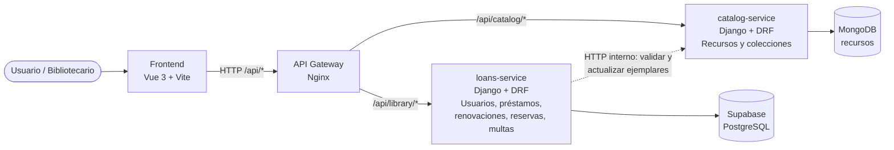
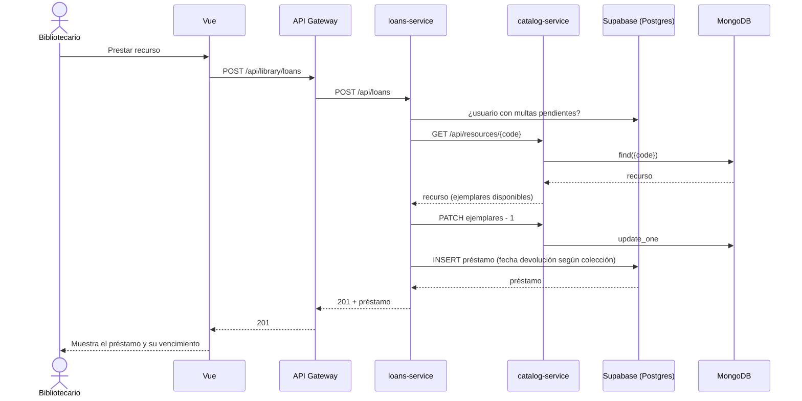

# Arquitectura de microservicios — SGB Universidad de Madeira

## Secuencia del flujo End-to-End (crear un préstamo)

## Responsabilidades
| Componente | Responsabilidad | Persistencia |
|---|---|---|
| Frontend (Vue) | UI; solo habla con el gateway | — |
| API Gateway (Nginx) | Enrutamiento por prefijo, CORS | — |
| catalog-service | Libros, diccionarios, revistas, mapas, equipos; estados y ejemplares | MongoDB (documentos con campos distintos por colección) |
| loans-service | Usuarios, préstamos, renovaciones, reservas, multas y reglas de negocio | Supabase / PostgreSQL (relacional, integridad referencial) |

Justificación de bases de datos: las colecciones tienen atributos heterogéneos (dimensiones en cm vs pulgadas, mapas sin ejemplares, ISSN vs ISBN), lo que encaja con documentos en MongoDB. Los préstamos, usuarios y multas son relacionales y transaccionales, lo que encaja con PostgreSQL.
